<p align="center">
  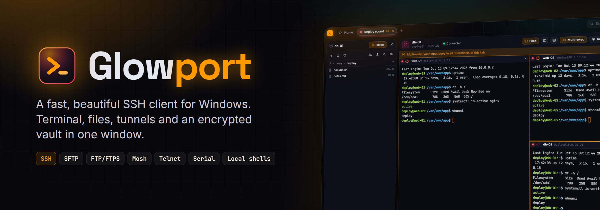
</p>

<p align="center">
  <a href="https://github.com/nihmir08/Glowport/releases/latest"></a>
  <a href="https://github.com/nihmir08/Glowport/releases"></a>
  
  <a href="LICENSE"></a>
</p>

<p align="center">
  <b>Glowport</b> brings your servers, keys, files and tunnels together in one fast, good-looking window.<br />
  Inspired by Termius and MobaXterm, built from scratch in Rust and TypeScript.
</p>

<p align="center">
  <a href="https://github.com/nihmir08/Glowport/releases/latest"></a>
</p>

<p align="center">
  <a href="#features">Features</a> ·
  <a href="#install">Install</a> ·
  <a href="#security">Security</a> ·
  <a href="#self-hosted-sync">Self-hosted sync</a> ·
  <a href="#building-from-source">Build</a> ·
  <a href="#license">License</a>
</p>

---

## Features

<table>
  <tr>
    <td width="33%" valign="top"><b>🖥️ Terminal</b><br />Tabs, freely split panes, saved workspaces, multi-exec, session recording, suggestions while you type.</td>
    <td width="33%" valign="top"><b>🔐 Encrypted vault</b><br />Hosts, groups with inheritance, identities, keys and snippets – all encrypted with your master password.</td>
    <td width="33%" valign="top"><b>📁 Files</b><br />SFTP, FTP and FTPS. A file panel next to the terminal, a two-pane manager, resumable parallel transfers.</td>
  </tr>
  <tr>
    <td valign="top"><b>🔀 Port forwarding</b><br />Local, remote and dynamic (SOCKS) rules that keep running without an open terminal.</td>
    <td valign="top"><b>⚡ Snippets &amp; macros</b><br />Commands with variables, hotkeys, run on many hosts at once with a result per host.</td>
    <td valign="top"><b>📊 Server tools</b><br />Live server info, Docker containers, systemd services, processes and Proxmox VMs.</td>
  </tr>
  <tr>
    <td valign="top"><b>☁️ Self-hosted sync</b><br />Your own sync server, end-to-end encrypted, with shared vaults and read/write roles.</td>
    <td valign="top"><b>📥 Import from anywhere</b><br />OpenSSH, PuTTY, MobaXterm, WinSCP, SecureCRT, mRemoteNG, Xshell, Windows Terminal, FileZilla and more.</td>
    <td valign="top"><b>🎨 Make it yours</b><br />Dark and light mode, accent color, 15 terminal color schemes plus import, fonts, ligatures, background images.</td>
  </tr>
</table>

### Hosts and groups

Organise your servers in nested groups. Set the user, key, jump host or color scheme once on a group and every host inside inherits it – and always shows where a value comes from.

<p align="center">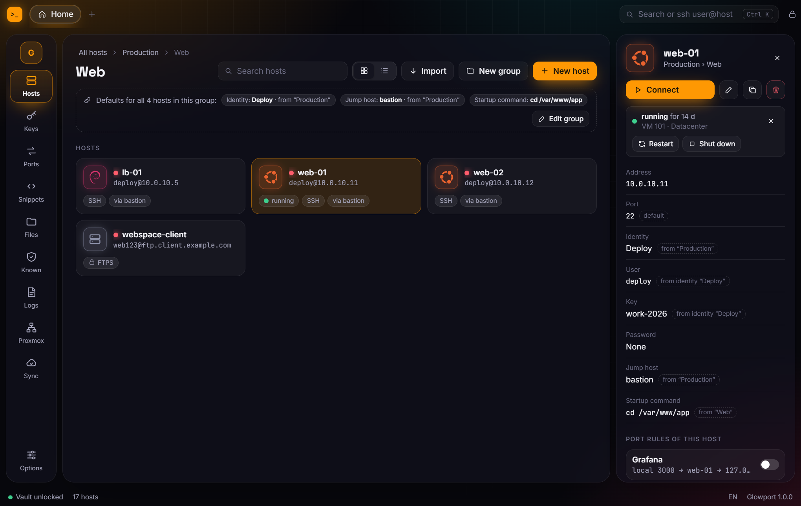</p>

<details>
<summary><b>More: the overview with workspaces and groups</b></summary>
<br />
<p align="center">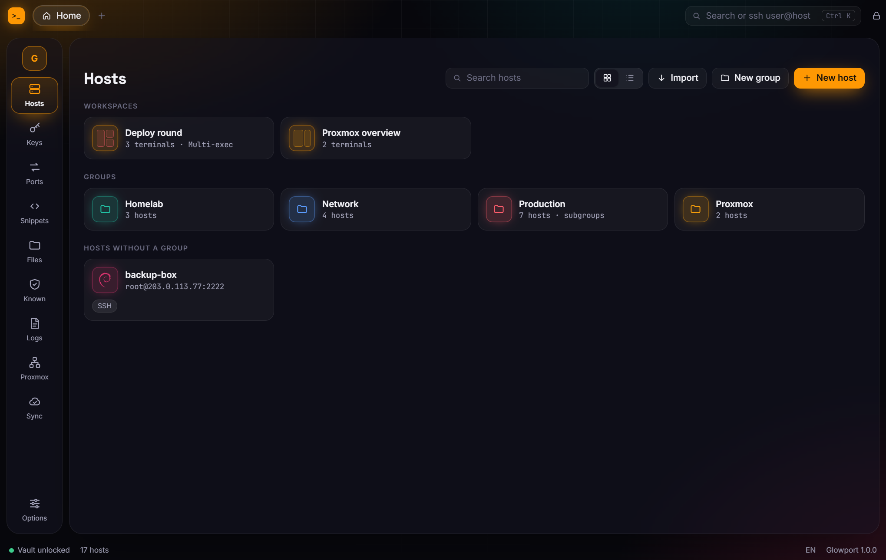</p>
</details>

### Terminal

Split a tab as often as you like, drag panes around, save the layout as a workspace and open it again with one click. Multi-exec sends your input to every pane at once.

<p align="center">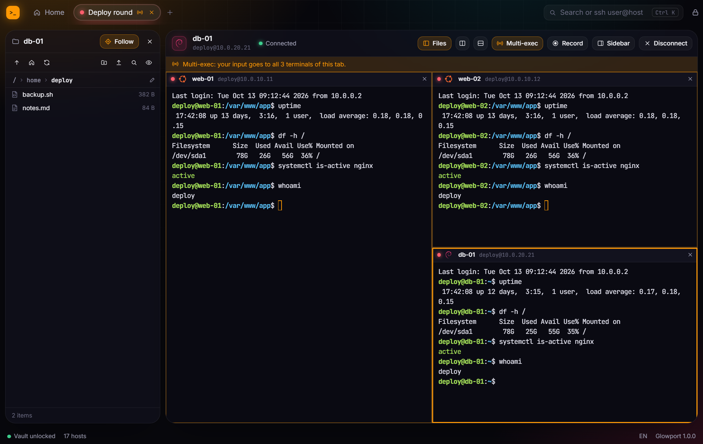</p>

### Server info, Docker and Proxmox

The sidebar next to the terminal shows CPU, memory, disks and network of the server – and lets you manage Docker containers, systemd services and processes. Proxmox VMs and containers can be started, stopped and turned into hosts.

<table>
  <tr>
    <td width="50%">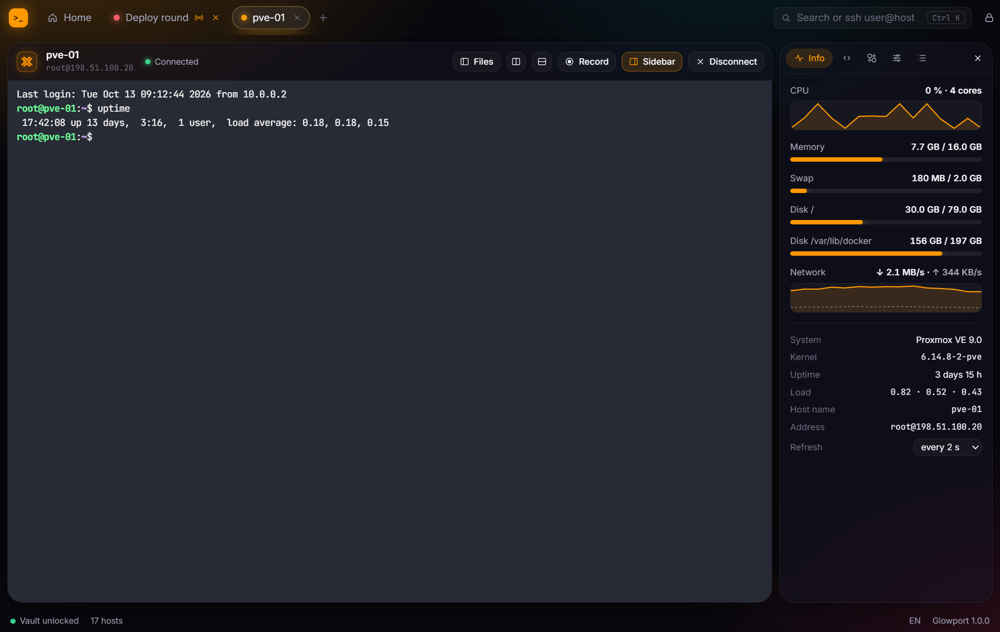</td>
    <td width="50%">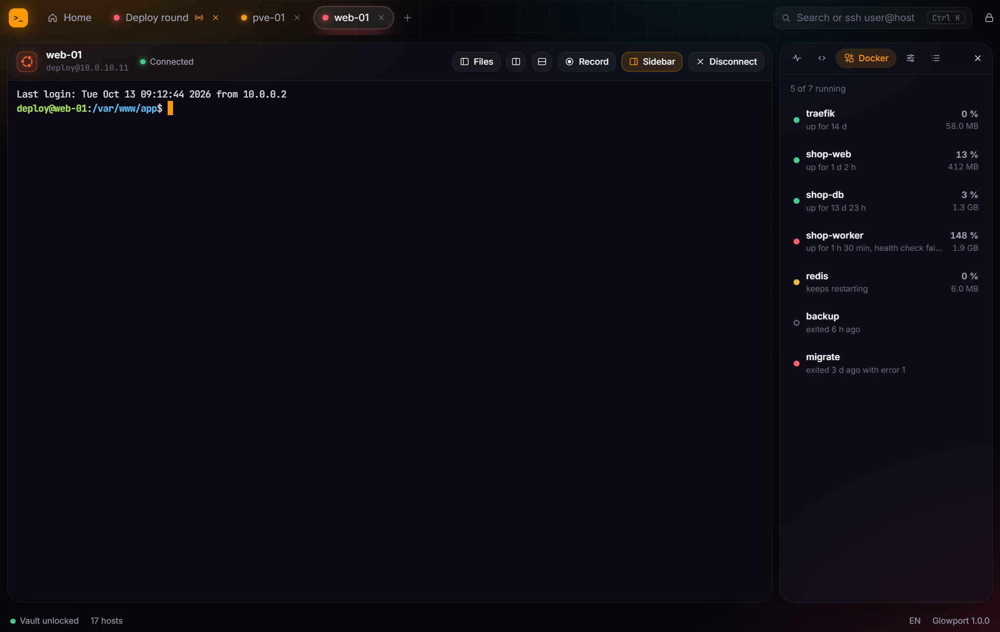</td>
  </tr>
  <tr>
    <td colspan="2">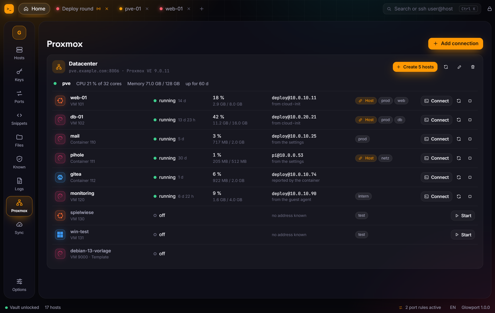</td>
  </tr>
</table>

### Files

A file panel follows your terminal into the current folder. The two-pane manager copies between this PC and a server or directly from server to server – in parallel, resumable even after a restart. Edit remote files in the built-in editor or your own, they upload when you save.

<table>
  <tr>
    <td width="50%">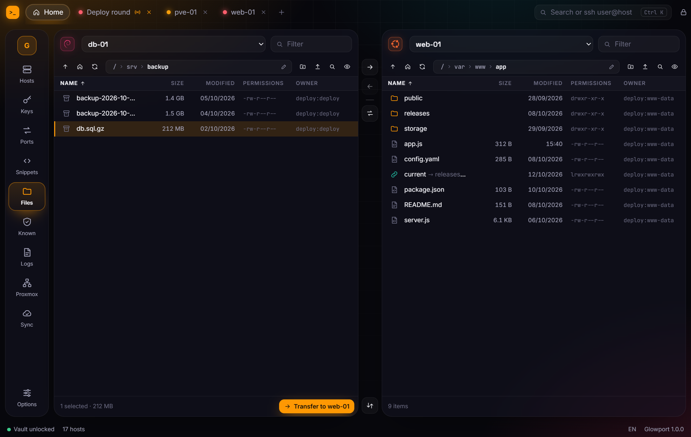</td>
    <td width="50%">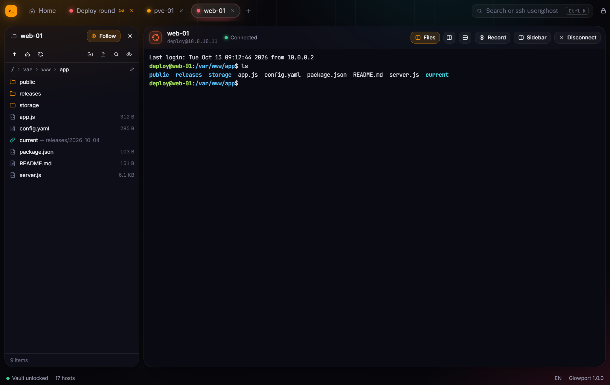</td>
  </tr>
</table>

### Port forwarding

<p align="center">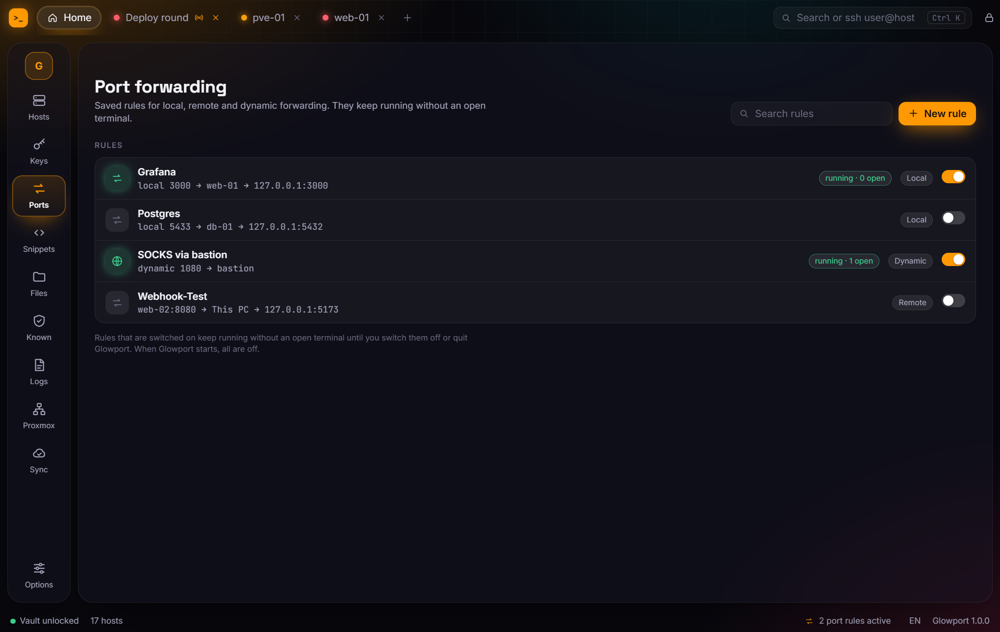</p>

### Snippets on many hosts

<p align="center">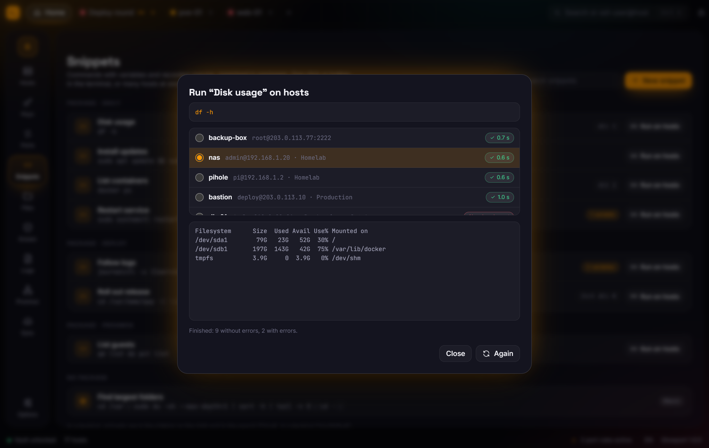</p>

### Keys and identities

Generate ed25519, RSA and ECDSA keys, import OpenSSH and PuTTY keys, copy a public key to many hosts at once. Agent, agent forwarding and SSH certificates are supported.

<p align="center">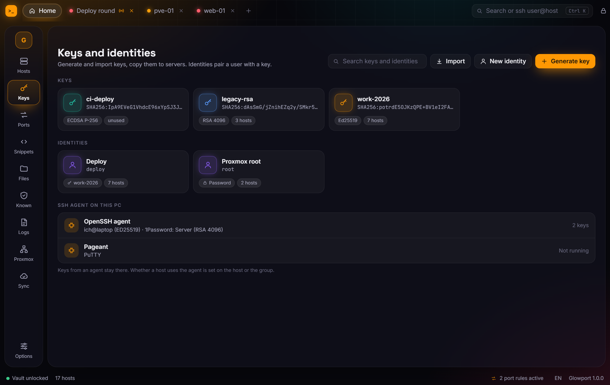</p>

### Sync and sharing

Run the small sync server on your own machine. Everything is encrypted on your devices before it leaves them; the server never sees a host, key or password. Share vaults with friends or your team and check their safety code.

<p align="center">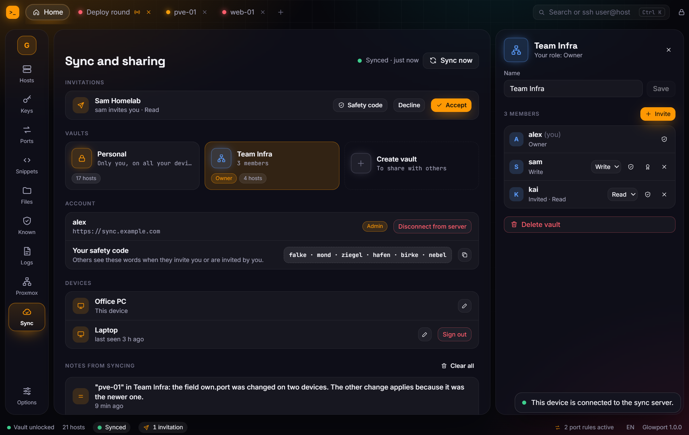</p>

### Import, quick connect and themes

<table>
  <tr>
    <td width="50%">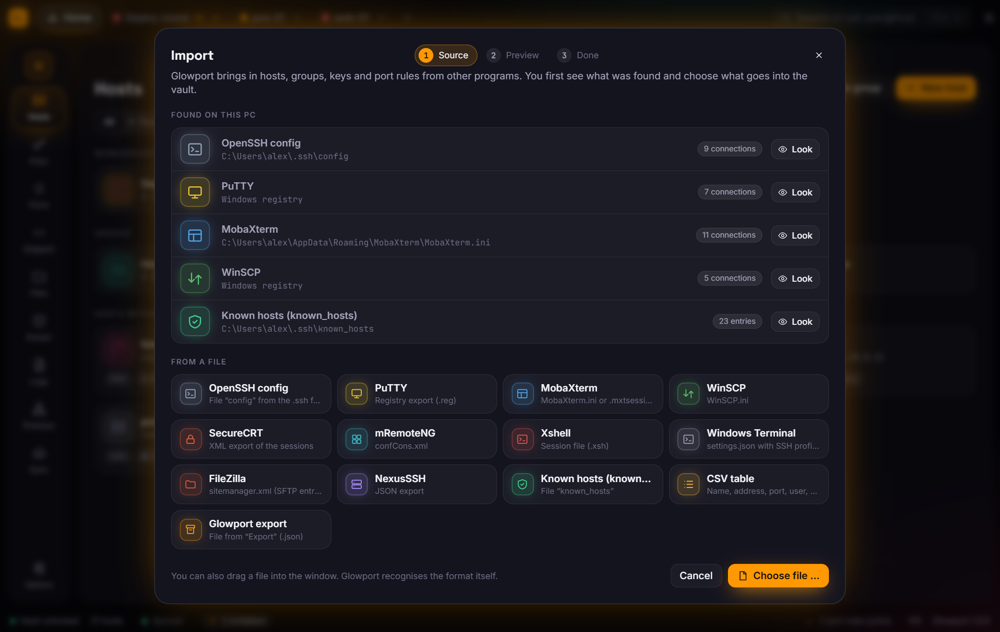</td>
    <td width="50%">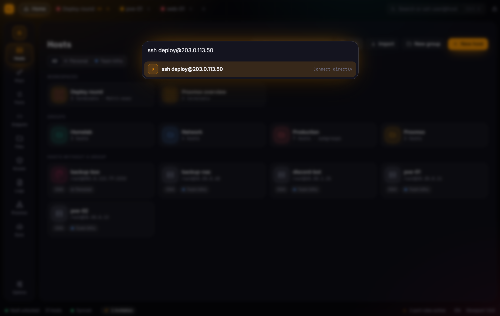</td>
  </tr>
  <tr>
    <td width="50%">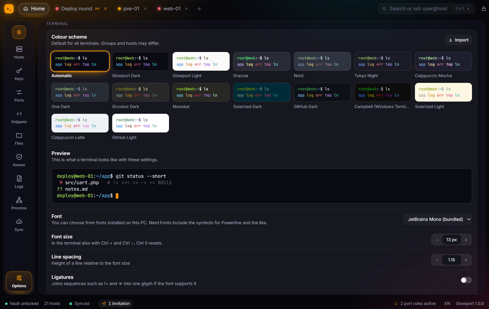</td>
    <td width="50%">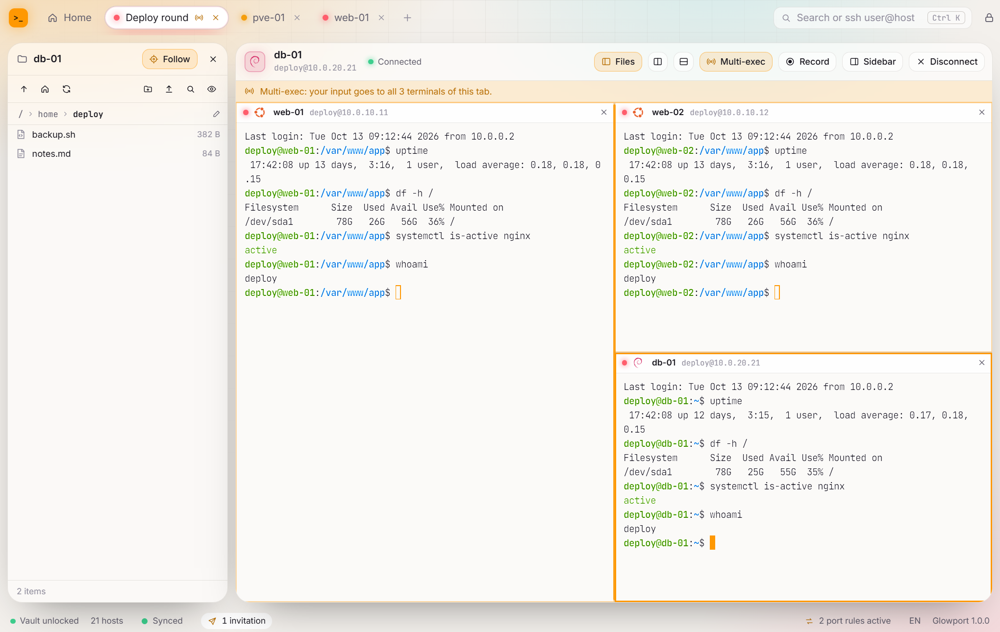</td>
  </tr>
</table>

### Protocols

| | |
| --- | --- |
| **SSH** | Password, keys, agent (Windows OpenSSH, Pageant, 1Password, Bitwarden), agent forwarding, certificates, jump host chains, HTTP and SOCKS proxies |
| **Mosh** | Keeps the session alive through connection dropouts; falls back to SSH when `mosh-server` is missing |
| **SFTP · FTP · FTPS** | One file manager for all of them |
| **Telnet · Serial** | For switches, routers and microcontrollers |
| **Local shells** | PowerShell, cmd, WSL and Git Bash in the same tabs |

## Install

1. Download `Glowport_<version>_x64-setup.exe` from the [latest release](https://github.com/nihmir08/Glowport/releases/latest) and run it. No administrator rights needed.
2. Windows may show *“Windows protected your PC”* the first time, because Glowport is not signed with a paid certificate. Click **More info → Run anyway**.
3. Create your vault with a master password – and keep it safe: there is no way to reset it.

**Updates** arrive by themselves. Glowport looks for a new version at startup and every hour, shows what changed and installs it after you agree. Every update is signed and checked before it runs.

**Portable:** `Glowport_<version>_x64_portable.zip` keeps all data in a `data` folder next to the program. It does not update itself.

Glowport needs the Microsoft WebView2 runtime, which ships with Windows 11 and is present on most Windows 10 systems.

## Security

- The vault is encrypted with **XChaCha20-Poly1305**; the key is derived from your master password with **Argon2id** (256 MiB, 4 passes). Sharing uses **X25519** and **Ed25519**. All primitives come from audited Rust crates – no home-grown cryptography.
- Your master password is never stored. Optionally Glowport can open without it, protected by Windows (DPAPI).
- No account, no cloud, no telemetry. On its own, Glowport only asks GitHub for updates. Everything else goes only to the servers you connect to.

## Self-hosted sync

`glowport-sync` is a single program for Linux (or a Docker image). Put it behind your own domain, create the first account with the setup code, invite others from within Glowport. The setup guide is in [docs/sync-server.md](docs/sync-server.md), the protocol in [docs/sync.md](docs/sync.md) and the vault format in [docs/vault.md](docs/vault.md).

## Building from source

Requirements: Windows 10/11, [Rust](https://rustup.rs) (stable), [Node.js](https://nodejs.org) 22 or newer, and the Visual Studio Build Tools with the C++ workload.

```powershell
git clone https://github.com/nihmir08/Glowport.git
cd Glowport
npm ci
npm run tauri dev      # start in development mode
npm run installer      # build the installer into target\release\bundle\nsis
```

The Rust core lives in `crates/` (SSH and files on top of [russh](https://github.com/Eugeny/russh), vault, sync, import), the desktop app in `src-tauri/`, the interface (Svelte 5, xterm.js) in `src/`.

## License

Glowport is free software under the [MIT license](LICENSE). It is built on the work of many open-source projects – see [THIRD-PARTY-LICENSES.md](THIRD-PARTY-LICENSES.md). Operating system logos come from [Simple Icons](https://simpleicons.org); all trademarks belong to their owners.
